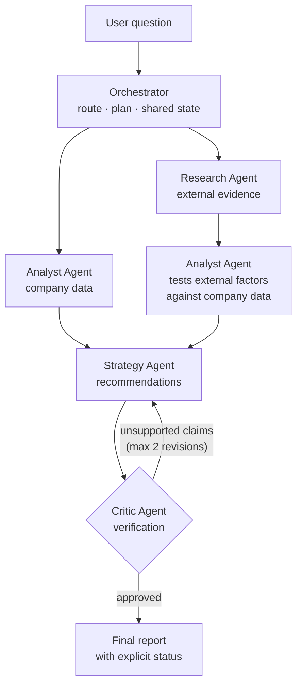

<p align="center">
  
</p>

<p align="center">
  
  
  
  
  
  
  
  
</p>

<h3 align="center">A team of specialist AI agents that investigates a business question together<br/>and delivers one evidence-checked report.</h3>

<p align="center">
  <a href="#-overview">Overview</a> ·
  <a href="#-how-it-works">How it works</a> ·
  <a href="#-getting-started">Getting started</a> ·
  <a href="#-evaluation-plan">Evaluation</a> ·
  <a href="#️-limitations">Limitations</a>
</p>

---

## 📑 Table of Contents

- [Overview](#-overview)
- [Key Features](#-key-features)
- [How It Works](#-how-it-works)
- [The Team](#-the-team)
- [Report Statuses](#-report-statuses)
- [Design Principles](#-design-principles)
- [Tech Stack](#️-tech-stack)
- [Getting Started](#-getting-started)
- [Configuration](#️-configuration)
- [Project Structure](#-project-structure)
- [Project Status](#-project-status)
- [Evaluation Plan](#-evaluation-plan)
- [Limitations](#️-limitations)
- [Future Improvements](#-future-improvements)
- [Author](#-author)
- [License](#-license)

---

## 📖 Overview

**AI Multi-Agent System** (the app is titled *AI Business Intelligence Team*) answers open-ended business questions such as:

> *"Analyze our sales, research the market, and recommend what to do next."*

Rather than asking one model to do everything, the work is split across agents that each own **one responsibility**, can use **only their own tools**, and pass **validated, structured results** to the next agent. An Orchestrator decides who runs and when. A Critic then checks the draft against the evidence before anything is released.

The result is a report that always states **what it is** — verified, partially verified, or lacking evidence — instead of presenting every answer as equally certain.

It builds on the earlier AI Business Agent project (SQLite business data, grounded analysis, and an honest "insufficient evidence" fallback), now re-architected as a multi-agent system.

---

## ✨ Key Features

- **Specialist agents** — Research, Analyst, Strategy and Critic, coordinated by an Orchestrator.
- **Validated handoffs** — every message between agents is a Pydantic model; malformed or unsupported output fails at the handoff, not three steps later.
- **Evidence-linked reasoning** — every finding cites evidence IDs, every recommendation cites finding IDs, and the shared state rejects references to anything that does not exist.
- **Two-layer Critic** — deterministic checks (numbers, URLs, citations) plus an optional LLM judgment on whether the evidence supports each claim, with a bounded revise loop.
- **Parallel execution** — independent tasks run concurrently, while dependent tasks wait for their inputs.
- **Graceful failure** — a failing agent never crashes the run; it becomes a status and a stated limitation in the report.
- **Cost and abuse controls** — hard cap on agent calls per run, per-session run limit, and an optional password gate.
- **Transparent runs** — the UI shows the plan, per-task status and timing, handoffs, LLM calls, token usage and revision count.

---

## 🔍 How It Works



1. **Route** — a rule-based router reads the question and picks the agents needed. If it cannot tell what is being asked, it asks the user to clarify instead of guessing.
2. **Plan** — the chosen agents become a task graph with hard and optional dependencies.
3. **Execute** — tasks run in waves; independent tasks run in parallel. The Orchestrator is the **only** writer of the shared state.
4. **Review** — the Critic checks the Strategy draft against the evidence. Unsupported claims send the draft back for revision, within a retry limit.
5. **Report** — the final report is released together with its verification status and any limitations.

---

## 👥 The Team

| Agent | Responsibility | Tools | Produces |
|---|---|---|---|
| **Orchestrator** | Routes the request, plans tasks, manages shared state, combines results | Shared state | Execution plan + final report |
| **Research Agent** | Collects external market information | Web search via Tavily (optional) | Sourced external factors |
| **Analyst Agent** | Analyses the company's own data and tests external factors against it | Read-only SQLite queries | Numeric findings backed by evidence |
| **Strategy Agent** | Turns findings into recommendations | Findings from other agents | Evidence-linked recommendations |
| **Critic Agent** | Checks evidence, accuracy and missing information | Draft + evidence only | Approval, or a list of issues to fix |

Roles are enforced **in code, not just in prompts**: each agent receives only its own tool registry, and the base agent refuses any other tool name. Each agent also sees only the slice of shared state it needs, and the Critic never sees the writer's reasoning.

---

## 🏷️ Report Statuses

Every report carries one of these statuses so a reader knows how far to trust it.

| Status | Meaning |
|---|---|
| `verified` | Approved by the Critic |
| `not_fully_verified` | Produced, but the Critic still had unresolved issues (see limitations in the report) |
| `partial` | Findings produced, but no recommendations |
| `findings_only` | Only findings were requested |
| `insufficient_evidence` | The available data does not support a conclusion |
| `needs_clarification` | The question was too unclear to route |
| `error` | The run failed; the reason is shown |

---

## 🧭 Design Principles

- **One responsibility per agent.** An agent only exists if it does something the others do not.
- **Numbers come from code, not from the model.** The Analyst computes figures and findings in Python from tool results; the LLM is only asked to judge whether data supports a claim.
- **No evidence, no claim.** Findings need evidence, recommendations need findings, external factors need a source.
- **Simple first.** Sequential flow by default; parallelism and retries only where they genuinely help.
- **Fail visibly.** Errors become statuses and limitations, never silent gaps or crashes.
- **No invented facts.** If the evidence does not support a conclusion, the report says so.

---

## 🛠️ Tech Stack

| Layer | Technology |
|---|---|
| Language | Python 3.10+ |
| UI | Streamlit |
| Schemas and validation | Pydantic |
| Business data | SQLite (synthetic dataset, auto-built on first run) |
| LLM | OpenAI-compatible API (default: Groq, `openai/gpt-oss-120b`) |
| External research | Tavily Search API (optional) |
| Concurrency | `ThreadPoolExecutor` |
| Testing | pytest |

---

## 🚀 Getting Started

### Prerequisites

- Python 3.10 or newer
- An API key for an OpenAI-compatible LLM endpoint (a free Groq key works)
- *(Optional)* a Tavily API key for the Research Agent's web search

### Installation

```bash
# 1. Clone the repository
git clone https://github.com/mirzayasirabdullahbaig07/09-AI-Multi-Agent-System.git
cd 09-AI-Multi-Agent-System

# 2. Create and activate a virtual environment
python -m venv venv
source venv/bin/activate        # On Windows: venv\Scripts\activate

# 3. Install dependencies
pip install -r requirements.txt

# 4. Configure environment variables
cp .env.example .env            # On Windows: copy .env.example .env
# then add your LLM API key to .env (see Configuration below)
```

### Run the app

```bash
streamlit run src/app.py
# or: python -m streamlit run src/app.py
```

The business database is built automatically on first launch. To rebuild it manually:

```bash
python -m src.tools
```

### Run the tests

```bash
pytest
```

### Example questions

- *Analyze our sales, research the market, and recommend what to do next.*
- *Why did our revenue drop this month, and what should we do next?*
- *What are our top products in June?*

---

## ⚙️ Configuration

Settings are read from environment variables (or a local `.env`) first, then from Streamlit secrets, so the same code runs locally and on Streamlit Community Cloud.

| Variable | Required | Default | Description |
|---|---|---|---|
| `OPENAI_API_KEY` | Yes | — | API key for the LLM endpoint (a Groq key starts with `gsk_`) |
| `OPENAI_BASE_URL` | No | `https://api.groq.com/openai/v1` | Any OpenAI-compatible endpoint |
| `LLM_MODEL` | No | `openai/gpt-oss-120b` | Model name |
| `TAVILY_API_KEY` | No | — | Enables the Research Agent's web search |
| `APP_PASSWORD` | No | — | If set, the app asks for a password before use |
| `MAX_RUNS_PER_SESSION` | No | `10` | Runs allowed per browser session |
| `SAVE_RUNS` | No | off | Set to `true` to save each run's state to `runs/` |

Built-in safeguards (see `src/config.py`): a **12-call cap** on agent calls per run, a maximum of **2 Critic revision rounds**, a **45-second** LLM timeout, and **3 attempts** with exponential backoff on transient errors.

> **Security note:** never commit `.env`. Saved runs in `runs/` contain business data and should stay out of Git.

---

## 📂 Project Structure

```
09-AI-Multi-Agent-System/
│
├── README.md
├── LICENSE
├── requirements.txt
├── .env.example
│
├── src/
│   ├── app.py                  # Streamlit front end
│   ├── orchestrator.py         # routing, planning, parallel execution, Critic loop
│   ├── state.py                # shared run state (single writer, per-agent views)
│   ├── schemas.py              # Pydantic models for every handoff
│   ├── tools.py                # SQLite data tools + web search + dataset builder
│   ├── prompts.py              # system prompts
│   ├── config.py               # settings, limits, paths
│   └── agents/
│       ├── base.py             # LLM client, retries, usage meter, tool enforcement
│       ├── research_agent.py
│       ├── analyst_agent.py
│       ├── strategy_agent.py
│       └── critic_agent.py
│
├── data/                       # generated business data (SQLite + CSVs)
├── tests/
├── evaluation/
│   └── evaluation.csv
├── notes/
├── docs/
├── assets/
│   ├── banner.svg
│   └── screenshots/
└── journal.md
```

---

## 🚧 Project Status

| Component | Status |
|---|---|
| Orchestrator, routing and task planning | ✅ Implemented |
| Research, Analyst, Strategy and Critic agents | ✅ Implemented |
| Validated Pydantic handoffs and shared state | ✅ Implemented |
| Streamlit app with password gate and run limits | ✅ Implemented |
| Automated tests | 🔄 In progress |
| Evaluation results (`evaluation/evaluation.csv`) | ⬜ Pending |
| Screenshots and live demo | ⬜ Pending |

Nothing is marked done until it has been tested.

---

## 🧪 Evaluation Plan

The system will be evaluated on a dataset in `evaluation/evaluation.csv`. Planned checks:

| Area | What is checked |
|---|---|
| Coordination | Do handoffs between agents carry the right data? |
| Tool selection | Does each agent use only its own, correct tools? |
| Evidence quality | Is every claim in the report backed by evidence? |
| Failure recovery | What happens on tool errors, timeouts and conflicting results? |
| Latency | How long does a full run take? |
| Cost | How many LLM calls and tokens does one report need? |

Results will be published here once they have been measured.

---

## ⚠️ Limitations

- A multi-agent run makes more LLM calls than a single agent, so it is slower and uses more of a free-tier quota.
- An LLM-based Critic can miss errors. It reduces unsupported claims but does not guarantee there are none, so approval is **not proof of truth**.
- The Critic's number check has known gaps: whole numbers under 10 are not checked, and a derived number (for example a difference computed from two evidence values) is flagged because it appears in no evidence.
- External research depends on the optional search API, and result quality varies.
- The bundled dataset is **synthetic**; conclusions drawn from it illustrate the system and are not real business advice.

---

## 🔮 Future Improvements

- [ ] Persistent memory across runs
- [ ] Human-in-the-loop approval before the final report is released
- [ ] Upload a company's own CSV files
- [ ] Export the final report as PDF or Word
- [ ] Optional LLM-based routing alongside the rule-based router

---

## 👨‍💻 Author

**Mirza Yasir Abdullah Baig**
Software Engineering & AI/ML Student | Building deployable AI/ML projects

- GitHub: [@mirzayasirabdullahbaig07](https://github.com/mirzayasirabdullahbaig07)

---

## 📄 License

This project is licensed under the MIT License — see the [LICENSE](LICENSE) file for details.
